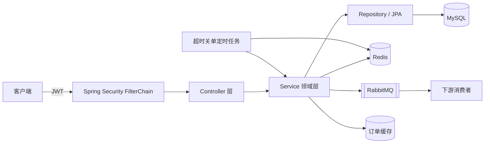
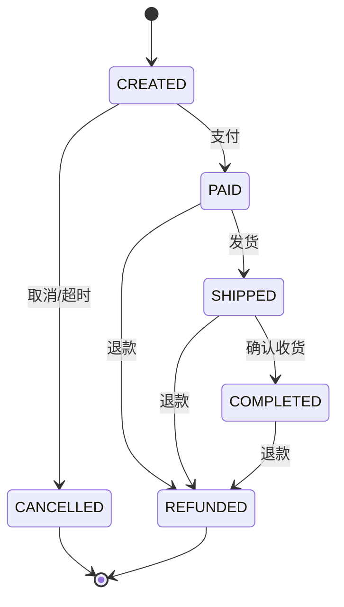

# 📦 Order Server — 企业级订单系统


## 一、项目简介

从「单表订单 Demo」重构而来的企业级订单后端服务，覆盖真实电商下单链路的完整技术要素：

- **分层架构**：`common` / `config` / `security` / `module` / `mq`，业务按领域拆分
- **认证授权**：Spring Security 7 + JWT 无状态认证，`USER` / `ADMIN` 角色隔离
- **订单状态机**：`待支付 → 已支付 → 已发货 → 已完成`，支持取消与退款，非法流转一律拒绝
- **库存一致性**：条件更新（`stock >= quantity`）+ 乐观锁版本号，数据库层面杜绝超卖
- **并发与幂等**：分布式锁（Lua 安全释放）+ 幂等键 + 悲观锁，三层防护
- **超时关单**：Redis ZSet 延迟队列 + 定时任务，多实例安全
- **事件驱动**：RabbitMQ Topic 交换机 + 死信队列，事务提交后异步广播订单事件
- **缓存**：Redis Cache-Aside 缓存订单详情，状态变更主动失效
- **工程规范**：统一响应体、全局异常、参数校验、链路追踪、数据库版本管理、监控指标、单元测试

## 二、系统架构



请求处理链路：

```text
TraceIdFilter → JwtAuthenticationFilter → Controller
    → 参数校验 → 幂等切面 → 分布式锁 → 事务模板
    → 扣库存 → 落订单 → 提交事务 → 注册延迟任务 → 发布事件
```

## 三、技术栈

| 分类 | 技术 | 版本 |
| --- | --- | --- |
| 语言 | Java | 21 |
| 框架 | Spring Boot | 4.1.1 |
| Web | Spring MVC | 7.0.9 |
| 安全 | Spring Security + JJWT | 7.1.1 / 0.13.0 |
| 持久化 | Spring Data JPA / Hibernate | 4.1.1 / 7.4.5 |
| 数据库 | MySQL | 8.4 |
| 迁移 | Flyway | 12.4.0 |
| 缓存 | Redis + Spring Cache | 7.4 |
| 消息 | RabbitMQ / Spring AMQP | 4.x / 4.1.1 |
| 文档 | SpringDoc OpenAPI | 3.0.0 |
| 监控 | Actuator + Micrometer Prometheus | - |
| 构建 | Maven | 3.10 |

## 四、项目结构

```text
src/main/java/com/team/orderserver
├── OrderServerApplication.java          # 启动类
├── common
│   ├── api          Result / PageResult / ResultCode
│   ├── constant     RedisKeys
│   ├── exception    BusinessException / GlobalExceptionHandler
│   ├── idempotent   @Idempotent / IdempotentAspect
│   ├── lock         RedisDistributedLock
│   ├── util         OrderNoGenerator
│   └── web          TraceContext / TraceIdFilter
├── config
│   ├── SecurityConfig / WebConfig
│   ├── RabbitMQConfig / OpenApiConfig
│   ├── TransactionConfig / DataInitializer
│   └── JwtProperties / OrderProperties / BootstrapProperties
├── security
│   ├── JwtTokenProvider / JwtAuthenticationFilter
│   ├── LoginUser / SecurityUtils / @CurrentUser
│   └── RestAuthenticationEntryPoint / RestAccessDeniedHandler
├── module
│   ├── auth         注册 / 登录 / 登出
│   ├── user         User 实体与仓库
│   ├── product      商品与库存
│   ├── order        订单、明细、状态机、超时调度
│   └── payment      支付流水
└── mq
    ├── OrderEventPublisher / OrderEventConsumer
    └── event/OrderEvent

src/main/resources
├── application.yaml / application-dev.yaml / application-prod.yaml
└── db/migration/V1__init_schema.sql
```

## 五、快速开始

### 1. 启动中间件

本项目支持两种运行模式，按本机情况选择：

**模式 A：使用本机已安装的 MySQL / Redis（推荐，默认）**

```bash
docker compose up -d          # 只会启动 RabbitMQ
```

| 依赖 | 来源 | 端口 |
| --- | --- | --- |
| MySQL | 本机服务（MySQL80） | 3306 |
| Redis | 本机服务（Memurai / Redis） | 6379 |
| RabbitMQ | Docker 容器 `order-rabbitmq` | 5672 / 15672 |

RabbitMQ 管理台：<http://localhost:15672>（admin / admin123）

**模式 B：全容器化（本机没有 MySQL / Redis 时）**

先停止本机的 MySQL80 / Memurai 释放端口，然后：

```bash
docker compose --profile full up -d
```

| 服务 | 端口 | 账号 |
| --- | --- | --- |
| MySQL | 3306 | root / 1213 |
| Redis | 6379 | 无密码 |
| RabbitMQ | 5672 / 15672 | admin / admin123 |

> 若 `order_db` 是已存在的库，Flyway 会先 baseline 到 version 0 再执行 `V1__init_schema.sql`，不会覆盖已有数据。

### 2. 启动应用

```bash
# 推荐：先打包，再用独立 JAR 运行，避免 IDE 与 Maven 同时写 target/classes
mvn clean package -DskipTests
java -jar target/order-server-0.0.1-SNAPSHOT.jar

# 或开发模式（不要同时让 IDE 编译到 target/classes）
mvn spring-boot:run
```

首次启动自动完成：

- Flyway 执行 `V1__init_schema.sql` 建表
- 创建管理员 `admin / admin123`
- 写入 3 个演示商品

### 3. 接口文档

- Swagger UI：<http://localhost:8080/swagger-ui.html>
- OpenAPI JSON：<http://localhost:8080/v3/api-docs>
- 健康检查：<http://localhost:8080/actuator/health>
- Prometheus：<http://localhost:8080/actuator/prometheus>

## 六、接口清单

| 方法 | 路径 | 权限 | 说明 |
| --- | --- | --- | --- |
| POST | `/api/auth/register` | 公开 | 注册 |
| POST | `/api/auth/login` | 公开 | 登录获取 JWT |
| POST | `/api/auth/logout` | 登录 | 令牌加入黑名单 |
| GET | `/api/products` | 公开 | 商品分页 |
| GET | `/api/products/{id}` | 公开 | 商品详情 |
| POST | `/api/products` | ADMIN | 新增商品 |
| PUT | `/api/products/{id}` | ADMIN | 修改商品 |
| PUT | `/api/products/{id}/stock` | ADMIN | 调整库存 |
| POST | `/api/orders` | 登录 | 创建订单（支持 `Idempotency-Key`） |
| GET | `/api/orders` | 登录 | 订单分页（管理员可查全部） |
| GET | `/api/orders/{orderNo}` | 登录 | 订单详情（带缓存） |
| POST | `/api/orders/{orderNo}/pay` | 登录 | 支付 |
| POST | `/api/orders/{orderNo}/cancel` | 登录 | 取消并归还库存 |
| POST | `/api/orders/{orderNo}/complete` | 登录 | 确认收货 |
| POST | `/api/orders/{orderNo}/ship` | ADMIN | 发货 |
| POST | `/api/orders/{orderNo}/refund` | ADMIN | 退款 |

统一响应：

```json
{
  "code": 200,
  "message": "操作成功",
  "data": { },
  "traceId": "8f3c...",
  "timestamp": 1761033600000
}
```

## 七、核心设计说明

### 1. 防重复下单（三层防护）

| 层级 | 手段 | 作用 |
| --- | --- | --- |
| 接口层 | `Idempotency-Key` + Redis SETNX | 客户端重试/重复点击直接拦截 |
| 服务层 | `order:lock:create:{userId}` 分布式锁 | 同一用户并发下单串行化 |
| 数据层 | 条件更新 `stock >= quantity` | 库存不会被扣成负数 |

### 2. 分布式锁的正确姿势

```text
加锁：SET key token NX PX 10000（原子）
解锁：Lua 判断 value == token 后再 DEL（防误删）
```

### 3. 状态机



所有状态变更都经过 `OrderStateMachine` 校验，且使用悲观锁（`SELECT ... FOR UPDATE`）防止并发覆盖。

### 4. 超时关单

下单成功后把 `orderNo` 写入 Redis ZSet，score 为到期时间戳；定时任务每 10 秒扫描到期订单，加分布式锁后关闭并归还库存。相比直接 `DEL`，**关单成功才移除**，异常时下次扫描自动重试。

### 5. 消息可靠性

- 事件在**事务提交后**发布，避免"消息到了、数据没落库"
- 队列持久化 + 死信队列兜底
- 发布失败仅记录日志，不阻断主流程（最终一致性由定时任务补偿）

### 6. 安全设计

- 密码 BCrypt 加盐哈希
- JWT 使用 HS256，密钥长度强制校验
- 登出通过 `jti` 黑名单实现（TTL = 令牌剩余有效期）
- 资源归属校验：普通用户只能操作自己的订单

## 八、配置说明

所有敏感配置均支持环境变量覆盖：

| 环境变量 | 默认值 | 说明 |
| --- | --- | --- |
| `SPRING_PROFILES_ACTIVE` | `dev` | 运行环境 |
| `DB_HOST` / `DB_PORT` / `DB_NAME` | localhost / 3306 / order_db | 数据库 |
| `DB_USERNAME` / `DB_PASSWORD` | root / 1213 | 数据库账号 |
| `REDIS_HOST` / `REDIS_PORT` / `REDIS_PASSWORD` | localhost / 6379 / 空 | Redis |
| `RABBITMQ_HOST` / `RABBITMQ_USERNAME` / `RABBITMQ_PASSWORD` | localhost / admin / admin123 | MQ |
| `JWT_SECRET` | 内置默认值 | **生产必须替换**，至少 32 字节 |
| `ORDER_TIMEOUT_MINUTES` | 15 | 支付超时时间 |
| `ADMIN_USERNAME` / `ADMIN_PASSWORD` | admin / admin123 | 初始管理员 |

生产环境启动示例：

```bash
export SPRING_PROFILES_ACTIVE=prod
export JWT_SECRET="$(openssl rand -base64 48)"
export DB_PASSWORD="******"
java -jar target/order-server-0.0.1-SNAPSHOT.jar
```

## 九、测试

```bash
mvn test
```

| 测试类 | 覆盖点 |
| --- | --- |
| `OrderStatusTest` | 状态机所有流转组合 |
| `JwtTokenProviderTest` | JWT 签发、解析、篡改拒绝、密钥长度校验 |
| `OrderServiceImplTest` | 库存不足回滚、总价计算、锁竞争快速失败 |

## 十、生产化 checklist

- [ ] 替换 `JWT_SECRET`、数据库与管理员默认密码
- [ ] 修改 `OrderResponse` 等缓存 DTO 结构时，递增 `OrderCacheService.CACHE_NAME` 的版本号
      （record 的 serialVersionUID 固定为 0，旧缓存可被反序列化但新字段为 null）
- [ ] 引入 Nacos/Apollo 等配置中心
- [ ] 订单表按用户或时间分库分表
- [ ] 支付渠道接入真实网关，增加回调验签与对账
- [ ] MQ 消息增加业务唯一 ID + 消费幂等表
- [ ] 接入 SkyWalking / OpenTelemetry 分布式链路追踪
- [ ] 增加限流（Sentinel）与熔断降级
- [ ] 多实例部署时订单号引入雪花算法机器位
- [ ] 数据库备份、慢 SQL 监控与索引优化
